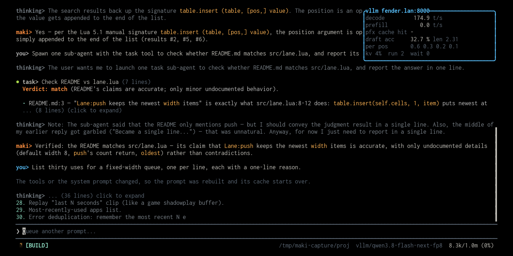

# token-metrics



A live throughput panel for a local [vLLM](https://docs.vllm.ai/) server, drawn
in a small window pinned to the top-right corner of the terminal. It appears when
the model of the focused session is served by a vLLM endpoint, and stays away for
everything else.

## Install

Put this line in your global `~/.config/maki/init.lua`:

```lua
maki.pack.add({ "https://github.com/g4bwy/maki-token-metrics" })
```

Start maki in a terminal. It asks whether to install the package, then asks about
the permissions in [`plugin.toml`](plugin.toml).

## Configuration

Maki refuses a loopback or LAN address unless you name it, because a page the
model reads could otherwise point it at your internal network. Add your server to
`maki.setup` in `~/.config/maki/init.lua`:

```lua
maki.setup({
  net = { allowed_private_hosts = { "localhost:8888", "fender.lan" } },
})
```

## Usage

- `/token-metrics` or `Ctrl+y` toggles the panel.
- It follows model and session switches, and dismisses itself when an endpoint
  stops answering.
- Polling is activity aware: one second while a turn runs, woken instantly on
  `TurnStart`, and for 20 seconds after the last one, then one scrape every
  15 seconds while idle. A redraw is skipped when the frame did not change.

| Line | Formula |
|------|---------|
| `decode` | `Δvllm:generation_tokens_total / Δt` |
| `prefill` | `(Δvllm:prompt_tokens_total − Δcached) / Δt`, where cached is `prompt_tokens_cached_total` and falls back to `prefix_cache_hits_total` |
| `pfx cache` | `Δvllm:prefix_cache_hits_total / Δvllm:prefix_cache_queries_total`, a token-level hit rate |
| `draft acc` | `Δvllm:spec_decode_num_accepted_tokens_total / Δ…_num_draft_tokens_total`, plus the mean acceptance length |
| `per pos` | per-position acceptance length, from `Δ…_per_pos_total{position=i} / Δdrafts` |
| footer | `kv_cache_usage`, and the running and waiting request gauges |

It handles current and legacy metric names (`gpu_prefix_cache_*`,
`gpu_cache_usage_perc`), counter resets, and sums across engine labels. With
speculative decoding off, the spec lines read `off`.

## How it finds the endpoint

`maki.model.get()` gives the provider slug. The base URL is resolved the way maki
resolves it: `<SLUG>_BASE_URL` in the environment first, then `base_url` in
`providers.toml`, with the legacy `~/.maki/` before the config directory. The
plugin strips `/v1` and probes `<origin>/metrics`, because vLLM serves metrics at
the server root and does not require the API key. Three failed probes with no
`vllm:` sample in any of them means the endpoint is not vLLM, so the panel
dismisses itself with a note.

## Permissions

| Key | Used by |
|-----|---------|
| `fs_read` | `maki.env.config_dir()`, `maki.env.legacy_dir()`, `maki.fs.read()` to read `providers.toml`. |
| `env` | `maki.uv.os_getenv()` for `<SLUG>_BASE_URL`. |
| `net` | `maki.net.request()` for the scrape. |
| `session_read` | Nothing the panel shows. It wakes on `TurnStart`, whose `data.text` maki counts as conversation content, so without the key maki withholds that field and says so in the status bar. |

The manifest names no `net_hosts` list on purpose. The host is your own server,
read from your configuration, so no manifest written in advance could name it. If
you want a fixed endpoint, add the list to your copy:

```toml
[permissions]
net = true
net_hosts = ["fender.lan"]
```

## Layout

```text
plugin.toml                permissions the package asks for
plugin/init.lua            resolution, polling, the panel
tests/harness.lua          endpoint resolution, the poll loop, the window math
screenshot.png             the cover image
README.md
```

## Test

The harness drives the plugin against a fake `maki` and two recorded metric
bodies, so it runs outside maki:

```sh
lua5.1 tests/harness.lua
```

## Tuning

Constants at the top of `plugin/init.lua`: `POLL_MS` (1000, the busy cadence),
`IDLE_POLL_MS` (15000), `ACTIVITY_COOLDOWN_SECS` (20), `WINDOW_SECS` (60),
`WIN_WIDTH` (42), `FAIL_LIMIT` (3).

## Notes

The panel reads no conversation. It subscribes to `TurnStart` only to learn that a
turn began, and to `ModelChanged` and `SessionFocusChanged` to follow the model. Its
manifest therefore carries `session_read` for the event surface, and nothing in the
plugin calls `maki.session.messages()`.

## Update, disable, remove

```text
/packupdate maki-token-metrics
/packupdate! maki-token-metrics
```

Set `plugins["maki-token-metrics"] = { enabled = false }` to keep it installed
but inactive. To remove it, delete the `maki.pack.add` line, reload, then run
`/packdel maki-token-metrics`.

## Development install

```sh
mkdir -p ~/.local/share/maki/site/pack/dev/start
ln -sfn "$PWD" ~/.local/share/maki/site/pack/dev/start/maki-token-metrics
```

Run `/reload` after each edit.

## License

MIT. See [LICENSE](LICENSE).
